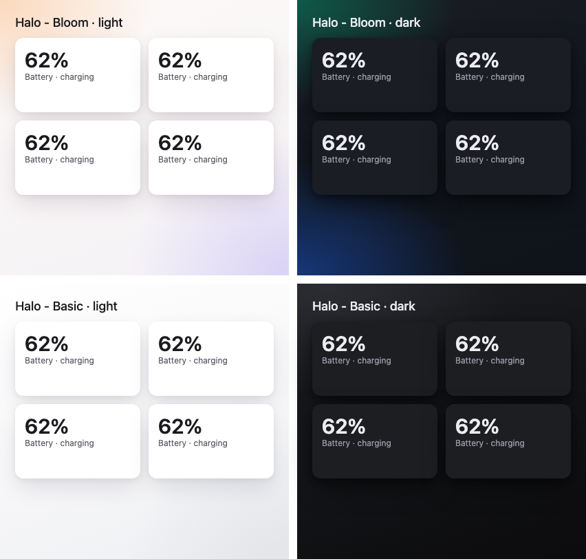

# Halo Theme

A Home Assistant theme to go with [Halo Cards](https://github.com/themistoapp/halo-cards), so Home Assistant's own screens, cards, dialogs and sidebar match them.



Two themes, installed together; pick either under Profile → Theme:

- **Halo - Bloom:** Halo's own bloom. Light is near white with a peach glow top left and lilac bottom right; dark is graphite with an aurora green glow top left and midnight blue bottom left.
- **Halo - Basic:** quiet and neutral. Light is almost white with the faintest grey corner; dark is plain graphite, lighter at the top left.

Both use the Halo cards' text, divider and card colours, 12px corners, Halo's soft shadow and no hairline border, an ink accent with toggles and sliders in Halo blue, and state colours (lights on, heating, cooling, locked, warnings) from the Halo palette.

## Install with HACS

1. HACS → ⋮ → **Custom repositories** → add `https://github.com/themistoapp/halo-theme`, category **Theme**.
2. Install **Halo Theme**.
3. Make sure `configuration.yaml` loads themes (once; restart Home Assistant after adding it):
   ```yaml
   frontend:
     themes: !include_dir_merge_named themes
   ```
4. Run the **frontend.reload_themes** action, then pick **Halo - Bloom** or **Halo - Basic** under Profile → Theme, with the mode on Auto to follow day and night.

A Halo Backdrop card on a view paints its sky over the theme's background.

## Install by hand

Copy [themes/halo.yaml](themes/halo.yaml) (use the **Raw** button) to `config/themes/halo.yaml`, then follow steps 3 and 4.
